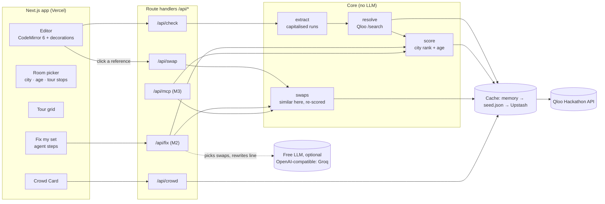

# Callback — Architecture

## Pitch

Callback is a spell-checker for cultural references. Paste anything written for an audience, such as a stand-up set, a toast, a keynote or a sales pitch, then pick the room: a city and an age band. Every reference gets underlined: **green**, this room knows it and loves it; **yellow**, they know it but don't care; **red**, it dies here. Click a red one and Callback suggests same-category swaps this city does love. **Tour mode** runs one set against every stop on a tour, so a comic knows what to swap in Atlanta and what to keep in Boston. **Fix my set** is an agent that does the swapping for you and shows its work.

### What makes it different

- **It checks your writing; it doesn't write for you.** The Qloo LLM Hackathon 2025 gallery (343 projects) was crowded with campaign and copy *generators* (Marketly, Qlaire, Cloutware, NexPR, AdBuddy, CulturaSync, and Resonance AI, which won). None checked text the user had already written, inline, reference by reference.
- **It only works with Qloo.** An LLM can guess clichés ("deep-dish for Chicago"). It can't tell you that Wawa is #1 in New York and dies in Atlanta, or that under-35s love *Love Island* and over-55s don't. Qloo's affinity data can, and that scoring is the product.
- **The UI is an editor, not a report.** Underlines are understood instantly; a judge can try it in under 30 seconds.
- **It works inside other agents.** An MCP server exposes the same checks to Claude Desktop, Cursor or any MCP client.

### Honest limitation

Qloo affinity measures *liking*, not *recognition*. "Lands" means: widely known (Qloo popularity) **and** this city ranks near the top of a pool of US cities for it. Every underline shows the rank and numbers behind it. Some very famous entities (*The Office*, Drake, Michael Jordan) carry no city-level data in Qloo; Callback marks those grey ("no data") instead of guessing.

## System overview



## Components

### Frontend (Next.js App Router, TypeScript)

- **Editor**: CodeMirror 6, plain text, prose-wrapped. References are mark decorations: green solid, yellow dashed, red wavy, grey dotted for no data. The shapes differ so colour is never the only signal.
- **Popover**: the verdict in one sentence, then Known / City rank / Vs typical, and for yellow and red up to 3 swaps with a one-click replace.
- **Room picker**: 12 US cities and an age band (`35_and_younger`, `36_to_55`, `55_and_older`, or any).
- **Tour mode**: up to 6 stops. A grid of references × cities with rank chips and a "Swap in X, Y" or "Keep" verdict per row. Clicking a city header opens the set in that room.
- **Crowd Card**: what the city over-indexes on, for openers and crowd work.
- **Share links**: text, room and tour compressed into the URL hash.

### Backend (Next.js route handlers)

| Route | Input | Output |
|---|---|---|
| `POST /api/check` | `{ text, rooms }` | references, each with a score per room |
| `POST /api/swap` | `{ entity, room }` | up to 3 scored swaps |
| `GET /api/crowd` | `city` | entities by type |
| `POST /api/fix` (M2) | `{ text, room }` | streamed agent steps and the fixed text |
| `/api/mcp` | MCP over Streamable HTTP | 6 tools, 2 prompts, 2 resources |

### Core pipeline (no LLM)

1. **Extract** (`src/lib/agent/extract.ts`): runs of capitalised words, with title joiners ("Parks and Recreation"). Sentence openers ("Then …") are stripped; pronouns, common first names, number words and the pool city names are skipped. A joined run that matches nothing is retried as pieces.
2. **Resolve**: Qloo `/search` restricted to brand, TV, movie, artist, person, podcast, video game and book. Unfiltered search returns individual store locations first, which have no location data. Exact names beat brand prefixes ("Dunkin'" → Dunkin' Donuts); then type order; matches under 0.3 popularity are rejected as probably wrong.
3. **Score** (`src/lib/scoring.ts`): see below.
4. **Swaps**: `/v2/insights` with `signal.interests.entities` (the original) and the city's location, take 40, then each candidate is scored with the same method. Only well-known candidates that rank above the median city are offered.

### The agent: "Fix my set" (M2)

A tool-using loop over the core:

- **Tools**: `check_set`, `find_swaps(reference, city)`, `apply_swap(reference, replacement, rewritten_sentence)`.
- **Loop**: check → pick the next reference that dies here → fetch swaps → choose the one that fits the joke (or keep it if nothing fits) → rewrite only that sentence → validate the rewrite → re-check → repeat until nothing is red or 6 steps have run. Each step streams to the UI as NDJSON.
- **Brain**: any OpenAI-compatible endpoint (`LLM_BASE_URL`, `LLM_API_KEY`, `LLM_MODEL`), Groq's free tier by default. The LLM's job is judgement Qloo can't give: the swap has to fit the line ("a guy who throws" needs a quarterback, not a running back), and grammar has to survive ("a Waffle House" → "an Applebee's").
- **Fallback**: no key, quota spent or a bad response → the same loop runs with rules (best-ranked green swap, name replaced in place). The demo never breaks; it's just less clever.

### MCP server (M3)

Exposes the core as tools at `/api/mcp`, so any MCP client (Claude Desktop, Cursor, ChatGPT connectors) can check and fix text. This is the hackathon's "integrate Qloo into an existing agent" path; the client's own model does the reasoning, so it costs us nothing.

## Scoring

Qloo exposes no national baseline: an insights call with no signal returns no affinity. So a reference is judged by **where this city ranks among a pool of cities**.

1. **Location profile**: for each entity type, one batched call per pool city: `filter.type`, `filter.results.entities=<ids>`, `signal.location=POINT(lon lat)`, `signal.location.radius=40000`. The pool is Atlanta, Boston, Chicago, Denver, Houston, Los Angeles, New York and Seattle, plus the room city if it's outside the pool. (`signal.location.query=<city>` silently drops many entities, e.g. Starbucks in Atlanta; the WKT point does not.)
2. **Strength**: affinities bunch near 1 (0.96 vs 0.9998), so they're stretched with `-log10(1 - a)`.
3. **Position**: rank in the pool, lift over the median city, raw spread across cities, and share of the top city's strength.
4. **Verdict**:
   - red if popularity < 0.25
   - yellow if the raw spread is < 0.005 (it plays the same everywhere: Starbucks, Taylor Swift)
   - green if in the top quarter of the pool, lift ≥ 1.15 and popularity ≥ 0.5
   - red if in the bottom 60% and below the median city, or outside the top quarter and under 70% of the top city's strength
   - yellow otherwise
5. **Age** is scored separately (age-only `signal.demographics.age`, one call per type and band). Combining age with location swamps the city signal. Absolute affinity ≥ 0.85 is a strong fit and < 0.66 is weak; weak knocks green down to yellow, never further.

Thresholds are pinned by tests on real Qloo numbers (`src/lib/scoring.test.ts`), e.g. Waffle House is green in Atlanta and red in Boston; Dunkin' is green in Boston; Starbucks is yellow everywhere.

**Crowd Card**: location only, no age (age plus location turned Atlanta into Orlando parks in testing). `bias.trends=high` for TV only; places use `filter.location` with a 20 km radius.

## Qloo limits and caching

The hackathon key allows **5 requests/second and 10,000 requests/month**. The monthly window covers both development and judging (Nov 2–16), so:

- A global throttle of 4 req/s; 429s retry after `x-second-ratelimit-reset`.
- Caching per entity × city and entity × age band, so a reference is fetched once, ever, and reused by every check that mentions it.
- **Cache layers**: memory → `src/lib/qloo/seed.json` (a committed snapshot of live responses covering the examples, so judges' default path costs nothing) → Upstash Redis when configured (shared across serverless instances). In local development, everything also persists to `.cache/qloo.json`.
- **Cost**: an uncached check of a new set is about 8 searches + 8 calls per entity type + 3 per type for age, roughly 40–60 calls.

## Data model

There's no user database; state lives in the URL hash and in browser storage.

```ts
type Room = { city: string; age: "any" | "35_and_younger" | "36_to_55" | "55_and_older" };
type Entity = { qlooId: string; name: string; type: QlooType; popularity: number; tags: Tag[] };
type Score = {
  roomKey: string; local: number; rank: number; of: number; lift: number; spread: number; ofTop: number;
  known: number; placeVerdict: Verdict; ageFit: "strong" | "neutral" | "weak" | null; verdict: Verdict;
};
type Reference = { id: string; start: number; end: number; surface: string; entity: Entity; scores: Score[]; age?: AgeProfile };
```

## Key demo flows

1. **Check a set (30 seconds)**: the stand-up example loads in Atlanta: Waffle House, Outkast and *P-Valley* are green; Tom Brady and Wawa are red. Switch to Boston and it nearly inverts.
2. **Fix a red one**: click Tom Brady, see "#4 of 8", pick a swap, and it turns green.
3. **Fix my set**: the agent works through the reds, picking swaps that fit each joke, and shows every step.
4. **Tour mode**: add Chicago, Houston and Denver to see what holds across the tour.
5. **Inside Claude Desktop**: add the MCP server, paste a set, and ask "will this work in Houston?"

## Stack and why

- **Next.js 15 + TypeScript on Vercel**: one deploy for the UI and API.
- **CodeMirror 6**: robust decorations on plain text.
- **Tailwind**: styled by hand; tokens in `globals.css`, designed light and dark themes.
- **No paid LLM**: the core is deterministic; the agent uses any OpenAI-compatible endpoint (Groq free tier), with a rules fallback.
- **Upstash Redis (optional)**: serverless-friendly shared cache.
- **Zod**: validates API input at the boundary.
- **Vitest**: scoring tests on real Qloo numbers, extractor tests, and pipeline tests on fixtures. Live tests run only with `QLOO_API_KEY`.

## Out of scope

- Accounts, teams and saved libraries (share links are enough)
- Audio or video input
- Non-US rooms
- Venue-level targeting (Qloo place entities carry no location affinity)
- Generating jokes; the agent only swaps references and the words around them

## Milestones

Deadline: **Oct 30, 2026, 11:45pm EDT**. Target submit: Oct 29.

| # | Dates | Ships | State |
|---|---|---|---|
| M0 | Oct 16 | Scaffold, repo, mock client | Done |
| M1 | Oct 16–20 | Editor, swaps, tour mode, Crowd Card, share links; **live Qloo client, city-rank scoring, LLM-free extraction, seed cache** | Done |
| M2 | Oct 20 | "Fix my set" agent: OpenAI-compatible LLM (Groq `openai/gpt-oss-120b`, `qwen/qwen3.8-27b` backup), check → swap → re-check loop, streamed steps, rules fallback, undo | Done |
| M3 | Oct 20 | MCP server at `/api/mcp`: `check_references`, `find_local_swaps`, `compare_cities`, `where_it_lands`, `crowd_card`, `fix_set`; prompts `localize_set`, `plan_tour`; resources `callback://method`, `callback://cities` (mcp-handler 2 + MCP SDK v2) | Done |
| M4 | Oct 20 | Vercel deploy, design pass, logo and favicon, link preview, quota guard, premise warning | Done (Upstash left optional) |
| M5 | Oct 20 | README, Devpost submission, demo video | Done |

### Decisions log

- **Oct 20: premise warning.** After testing the MCP connector in Claude, which noticed that a Chick-fil-A swap broke a "grew up in Boston" setup, `fix_set` now flags swaps whose paragraph names another city, and the MCP instructions tell the client to read the setup around each swap.
- **Oct 20: quota guard.** Below 300 calls left on the Qloo key (`QLOO_QUOTA_FLOOR`), the live client stops making new calls and the app says so. Cached lookups keep working, so the examples survive judging.

- **Oct 20: the agent loop is driven by code; the LLM makes the judgement calls.** Groq's free tier allows 8,000 tokens a minute, so a multi-turn tool-calling conversation would hit the limit. Each decision is one small JSON call (about 250–700 tokens): which swap fits the line, the rewritten sentence, or "none fits". Rewrites that drift from the writer's words are rejected and the rules take over.

- **Oct 20: no paid LLM.** The core runs on Qloo alone; the agent uses a free OpenAI-compatible model with a rules fallback. The Anthropic SDK was removed.
- **Oct 20: city rank instead of national lift.** Qloo returns no affinity without a signal, so there's no national baseline to divide by.
- **Oct 20: WKT point instead of `signal.location.query`.** The locality query silently drops entities.
- **Oct 20: age scored separately.** Combined with location it drowned out the city signal.
- **Oct 20: pool of 8 cities, not 12,** to fit the 10,000-call monthly quota.
- **Oct 20: places excluded from resolution.** Store locations crowded out brands, and venues have no location affinity.
- **Oct 16: tour mode hides the Crowd Card** and the editor underline shows the weakest city.
