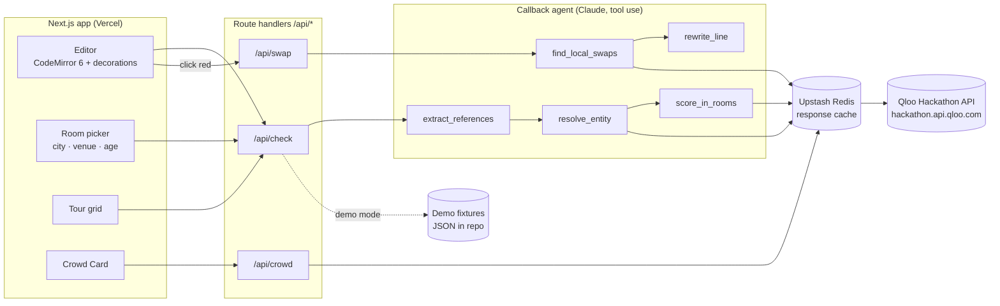

# Callback — Architecture

## Pitch

Callback is a spell-checker for cultural references. Paste anything written for an audience, such as a stand-up set, a toast, a keynote or a sales pitch, then pick the room: a city, optionally a venue, and an age band. Every reference gets underlined: **green**, this room knows it and loves it; **yellow**, they know it but don't care; **red**, it dies here. Click a red one and Callback suggests a local swap from the same category that this room does love, rewritten into your line. **Tour mode** runs the same set against every stop on a tour and shows a reference × city grid, so a comic knows what to swap in Atlanta and what to keep in Boston.

### What makes it different

- **It checks your writing; it doesn't write for you.** The Qloo LLM Hackathon 2025 gallery (343 projects) was crowded with campaign and copy *generators* (Marketly, Qlaire, Cloutware, NexPR, AdBuddy, CulturaSync, and Resonance AI, which won). None checked text the user had already written, inline, reference by reference.
- **It only works with Qloo.** An LLM can guess clichés ("deep-dish for Chicago"), but it can't score *this list of entities* against *this city and age band* relative to the national baseline. That scoring is the product.
- **The UI is an editor, not a report.** Underlines are understood instantly, and judges can try it in under 30 seconds with a preloaded set and the city dropdown.
- **Tour mode** maps onto a real workflow for comics and promoters. Two of the judges are Cedric the Entertainer and Live Nation's EVP of Strategic Initiatives.

### Honest limitation

Qloo affinity measures *liking*, not *recognition*. We approximate "will land" as **known** (popularity percentile) × **loved here** (local affinity lifted over the national baseline). Every underline shows those numbers, so the proxy is visible, and the README says so plainly.

## System overview



## Components

### Frontend (Next.js App Router, TypeScript)

- **Editor**: CodeMirror 6 in plain-text, prose-wrapped mode. References are shown as mark decorations. Hovering a mark shows a popover with the verdict, the numbers (popularity percentile, local lift, age delta) and up to 3 swaps with a one-click replace.
- **Room picker**: city (Qloo locality, via `signal.location.query`), an optional venue (a Qloo place entity), and an age band. The age band is one of Qloo's three values: `35_and_younger`, `36_to_55` or `55_and_older`, plus "any".
- **Tour mode**: up to 6 cities. A grid with references as rows and cities as columns shows verdict chips. Clicking a cell shows the editor in that room.
- **Crowd Card**: a side panel listing what this room loves right now (TV, artists, brands, places, people, movies), with trending items flagged. It's material for openers and crowd work.
- **Presets**: a stand-up set, a wedding toast and a sales pitch, each with a default room. These load from cached fixtures and work without a Qloo key.

### Backend (Next.js route handlers)

| Route | Input | Output |
|---|---|---|
| `POST /api/check` | `{ text, rooms: Room[] }` | `References[]` with a `Score` per room |
| `POST /api/swap` | `{ text, referenceId, room }` | up to 3 `Swap`s with rewritten lines |
| `GET /api/crowd` | `room` | `CrowdCard` |

All Qloo calls go through one `qloo` client that handles the `X-Api-Key` header, retries with backoff, and caches in Redis keyed by a hash of the normalised request (TTL 24h, or 6h for trend calls). The client and a fixture-backed mock share one interface, so work isn't blocked while the key is pending.

### The agent

Claude, using tool use, runs the reasoning steps. The Qloo math happens inside tools, in deterministic code.

1. **`extract_references`**: the LLM returns spans for every cultural reference: `{ start, end, surface, guessedType, roleInLine }`. `guessedType` is one of the Qloo types (`brand`, `place`, `tv_show`, `movie`, `artist`, `person`, `podcast`, `video_game`, `book`, `destination`). `roleInLine` is a short note such as "punchline target", "relatable shorthand for cheap" or "status symbol", which later guides swaps.
2. **`resolve_entity`**: Qloo `/search` by name and type. The LLM breaks ties when several candidates match (Atlanta the show vs. Atlanta the place). Results that can't be resolved are left unmarked rather than guessed.
3. **`score_in_rooms`**: deterministic batched scoring (see Scoring below).
4. **`find_local_swaps`**: takes the original entity's tags, then calls `/v2/insights` with the same `filter.type` and `filter.tags`/`signal.interests.tags`, plus the room's `signal.location.query` and age band, and `filter.popularity.min`. It scores the candidates against the baseline and keeps the ones with high lift.
5. **`rewrite_line`**: the LLM picks the 3 candidates that best fit `roleInLine` and rewrites only the reference span, keeping the writer's voice. It may not change anything else in the line.

### External services

- **Qloo Hackathon API** (`https://hackathon.api.qloo.com`, `X-Api-Key` header): `/search`, `/v2/insights`, `/v2/tags`.
- **Anthropic API**: extraction, disambiguation, swap selection and line rewrites. The model is chosen at M1, with a small, fast model for extraction.
- **Upstash Redis**: cache and per-IP rate limiting, so judges don't burn through the Qloo quota.
- **Vercel**: hosting.

## Scoring

For a room R (location L, age band A) and resolved references grouped by type T:

1. **Local**: `GET /v2/insights?filter.type=T&filter.results.entities=<ids>&signal.location.query=L&signal.demographics.age=A`, giving each entity's local affinity.
2. **Baseline**: the same call without the location, giving national affinity for the same age band.
3. **Per entity**:
   - `known` = Qloo popularity percentile (0–1)
   - `lift` = local affinity / baseline affinity
   - `ageDelta` = affinity with age band A vs. with no age signal (shown only)
4. **Verdict** (thresholds calibrated in M2 against a hand-labelled set of ~60 references):
   - **green**: `known ≥ K_hi` and `lift ≥ L_hi`
   - **yellow**: `known ≥ K_lo` and `lift` between `L_lo` and `L_hi`
   - **red**: `known < K_lo`, or `lift < L_lo`

Calls per check = (rooms + 1 baseline) × distinct types. With 6 tour cities and 4 types, that's 28 cached calls, not a call per reference.

**Venue (stretch)**: resolve the venue as a `place` entity and add it as `signal.interests.entities` with a weight, so the audience skews toward that venue's crowd. This ships only if the M1 spike shows it changes results meaningfully.

**Crowd Card**: for each of 6 types, `GET /v2/insights?filter.type=T&signal.location.query=L&signal.demographics.age=A&bias.trends=high&take=5`, ranked by lift over the baseline so it isn't just the national top 5.

> Verify in the M1 spike: the exact response field that carries per-entity affinity, whether popularity comes back from insights or only from search, and how `filter.results.entities` behaves with a location signal. The scoring module abstracts these so the formula can change in one place.

## Data model

There's no user database; state lives in the URL and in browser storage.

```ts
type AgeBand = "35_and_younger" | "36_to_55" | "55_and_older" | "any";
type Room = { city: string; venueId?: string; age: AgeBand };

type Reference = {
  id: string; start: number; end: number; surface: string;
  roleInLine: string;
  entity?: { qlooId: string; name: string; type: QlooType; popularity: number; tags: Tag[] };
};

type Score = { roomKey: string; local: number; baseline: number; lift: number;
               known: number; ageDelta?: number; verdict: "green" | "yellow" | "red" };

type Swap = { entity: Reference["entity"]; lift: number; known: number; rewrittenLine: string };

type CrowdCard = { room: Room; byType: Record<QlooType, { entity: Reference["entity"]; lift: number; trending: boolean }[]> };
```

- **Share links**: the text and rooms are compressed into the URL hash (lz-string), so a judge can open someone else's check.
- **Drafts**: kept in localStorage, wrapped in try/catch.

## Key demo flows

1. **Check a set (the 30-second path)**: open the app, see the preloaded stand-up set with Atlanta and 35-and-under selected, and the underlines appear. Switch the city to Boston and watch the underlines change colour.
2. **Fix a red one**: click a red brand reference to see the popover with the numbers and 3 local swaps. Click one, and the line is rewritten in place and turns green.
3. **Tour mode**: add Chicago, Houston and Denver. The grid shows which references hold up across the tour and which need a per-city swap. Clicking a cell opens that room's editor, with the Crowd Card alongside for openers.

## Stack and why

- **Next.js 15 + TypeScript on Vercel**: one deploy for the UI and API, with a live link from day 1.
- **CodeMirror 6**: robust decorations on plain text; we don't need rich text.
- **Tailwind + Radix primitives**: fast, accessible popovers and selects, styled by hand rather than kept at the defaults.
- **Anthropic SDK with tool use**: satisfies the agentic requirement in the open, since the agent decides which tools to call and when.
- **Upstash Redis**: serverless-friendly cache; protects the Qloo quota.
- **Zod**: validates the LLM's tool output and the Qloo responses at the boundary.
- **Vitest**: unit tests for scoring and verdict thresholds, plus fixture-based tests for the pipeline.

## Design direction

The editor is the hero, and it should feel like a writing tool (iA Writer, Linear docs), not a dashboard.

- **Type**: a grotesk with character for headings, Inter for body text, and a mono with tabular figures for scores.
- **Colour**: warm neutrals plus one accent. The verdict colours are reserved for underlines and chips only, tuned to work in both light and dark modes.
- **Icons**: Lucide, small.
- **Copy**: plain and specific.
- **Avoid**: gradients and "AI-powered" badges.

## Out of scope

- Accounts, teams and saved libraries (the URL share is enough)
- Audio or video input (the set is pasted text only)
- Non-English text and non-US rooms (US cities first; others work if Qloo resolves them, but they're untuned)
- Generating jokes or full rewrites; Callback only swaps the reference span
- A browser extension or Google Docs add-on (mentioned in the README as the business path)
- An MCP server wrapper (stretch, only if M5 has slack)

## Milestones

Deadline: **Oct 30, 2026, 11:45pm EDT**. Target submit: Oct 30, midday EDT.

| # | Dates | Ships | Demo-able result |
|---|---|---|---|
| M0 | Oct 16 | Repo, Next.js scaffold, Vercel deploy, Qloo key requested, Qloo client + mock interface | Live URL with the empty editor shell |
| M1 | Oct 17–19 | API spike to confirm the response fields; extract → resolve → score for one room; underlines in the editor | Paste a set, pick a city, see real green/yellow/red underlines |
| M2 | Oct 20–22 | Popover with the numbers; swap agent with rewrites; threshold calibration on a labelled set; Redis cache | Click red, accept a swap, line turns green |
| M3 | Oct 23–25 | Tour mode grid; Crowd Card with trends; age band delta | 4-city tour grid plus Crowd Card |
| M4 | Oct 26–28 | Design pass, presets + fixtures, empty/loading/error states, share links, rate limiting, venue signal if the spike supported it | A judge can do the 30-second path cold |
| M5 | Oct 29–30 | README (pitch, honest limitation, run locally), MIT LICENSE, `.env.example`, Devpost text, demo script, buffer | Submitted |

**Fallback if the key is late**: M1 and M2 run against the mock client with hand-built fixtures, then switch to live data the day the key arrives. Scope to cut first, in order: venue signal, age delta display, share links, Tour mode beyond 4 cities.
