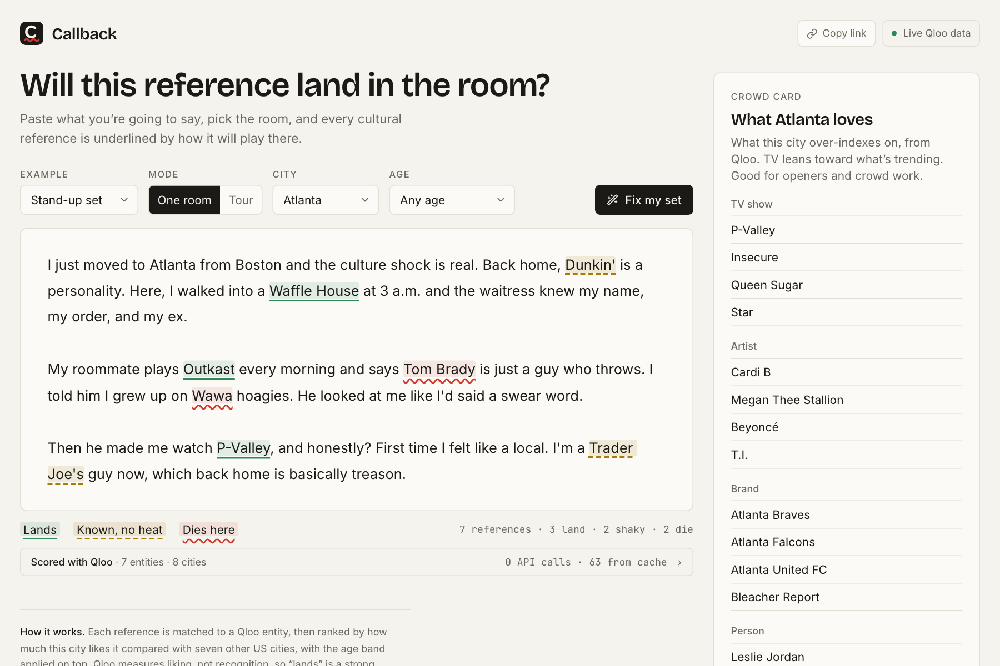

# Callback

A spell-checker for cultural references. Paste a stand-up set, toast, keynote or sales pitch, pick the room (city and age band), and every reference is underlined by how it will play there.

**Live demo:** https://callback-ecru-one.vercel.app · **MCP server:** `https://callback-ecru-one.vercel.app/api/mcp`



- **Green, solid**: widely known, and this city is one of the ones that likes it most.
- **Yellow, dashed**: known, but it plays about the same everywhere.
- **Red, wavy**: this city is one of the ones that likes it least. Click it for same-category swaps this city loves, and replace it in one click.
- **Grey, dotted**: Qloo has no city-level data for it, so Callback says so instead of guessing.

Built for the [Qloo Agentic Hackathon](https://qloo.devpost.com/).

## What's in it

- **The editor.** Click any underline for its rank across 8 US cities, a "where it lands" chart, the age-band read, and swaps with the Qloo tags they share.
- **Fix my set.** An agent swaps everything that dies, picks the swap that fits each joke, rewrites only that sentence, re-checks, and shows every step. Undo restores the original.
- **Tour mode.** One set against up to 6 cities, as a reference-by-city grid.
- **Crowd Card.** What the city over-indexes on, for openers and crowd work.
- **Qloo receipt.** Under every check: the endpoints and signals used, and API calls versus cache.
- **MCP server.** Six tools, two prompts and two resources, so any agent can use the same scoring.
- **Share links.** The text, room and tour are saved in the URL.

## Try it in a minute

1. Open the [live demo](https://callback-ecru-one.vercel.app). The stand-up set loads in Atlanta: Waffle House, Outkast and *P-Valley* land; Tom Brady and Wawa die.
2. Switch **City** to **Boston**. The same set nearly flips.
3. Back in Atlanta, click **Tom Brady** to see his rank in each city, the age read, and local swaps.
4. Click **Fix my set** and watch the agent swap what dies and explain each change. **Undo** restores the original.
5. Switch to **Tour**, add Denver, and read the reference-by-city grid.
6. Open **Scored with Qloo** under the editor to see which Qloo calls produced the verdicts.

## How it works

1. **Find the references.** Capitalised phrases are pulled from the text and resolved with Qloo `/search` (brands, TV, film, music, people, podcasts, games and books). No LLM is involved.
2. **Rank the city.** For each reference, Qloo `/v2/insights` gives its affinity in a pool of 8 US cities (`signal.location` as a map point). A reference **lands** when it's widely known and this city ranks near the top of the pool for it. It **dies** when this city sits well below the rest.
3. **Apply the age band.** Age is scored separately (`signal.demographics.age`). A weak fit stops a reference being a sure thing.
4. **Swap.** For a weak reference, Qloo suggests similar entities near the city (`signal.interests.entities`), and each one is ranked the same way before it's offered.
5. **Crowd Card.** What the city over-indexes on right now, with TV biased toward trending (`bias.trends`).

A plain LLM can only guess clichés. Qloo knows that Wawa is #1 in New York and dies in Atlanta, and that Waffle House is Atlanta's while Boston doesn't care.

### An honest limitation

Qloo affinity measures *liking*, not *recognition*. "Lands" is a proxy: popularity says people probably know it, and the city rank says this room likes it more than most. The numbers are shown on every underline. A few famous entities (*The Office*, Drake) have no city-level data in Qloo; they're marked grey rather than guessed.

## Qloo usage and limits

Qloo's hackathon key allows 10,000 calls a month and 5 a second. Calls are throttled to 4 a second, every entity-and-city result is cached once, `src/lib/qloo/seed.json` ships a snapshot that covers the examples, and new calls stop before the monthly quota runs out so the examples keep working.

## Use Callback inside your agent (MCP)

Callback is also an MCP server, so Claude Desktop, Cursor, VS Code or any MCP client can check and fix text with the same Qloo-backed scoring. The endpoint is `/api/mcp` (Streamable HTTP, stateless).

| Tool | What it does | Qloo features used |
|---|---|---|
| `check_references` | Every reference in a text: lands, shaky, dies or no_data, with the city's rank | `/search`, `/v2/insights` with `filter.results.entities` + `signal.location`, `signal.demographics.age` |
| `find_local_swaps` | Same-category replacements the city ranks highly, with shared Qloo tags | `signal.interests.entities` near the city, then ranked across the pool |
| `compare_cities` | One set across up to 6 tour stops | as `check_references`, per city |
| `where_it_lands` | One reference ranked across every city, plus which age bands like it | `signal.location` × 8 cities, `signal.demographics.age` × 3 bands |
| `crowd_card` | What a city over-indexes on: TV, artists, brands, people, places | `signal.location`, `bias.trends` (TV), `filter.location` (places) |
| `fix_set` | Callback's own agent swaps everything that dies and returns the new text | all of the above |

There are also two prompts (`localize_set`, `plan_tour`) and two resources (`callback://method`, the scoring method; `callback://cities`).

**Claude Desktop**: Settings → Connectors → Add custom connector, and paste `https://callback-ecru-one.vercel.app/api/mcp`. Or, for stdio-only clients, in the config file:

```json
{
  "mcpServers": {
    "callback": { "command": "npx", "args": ["-y", "mcp-remote", "https://callback-ecru-one.vercel.app/api/mcp"] }
  }
}
```

**Cursor / VS Code**: add a server with `"url": "https://callback-ecru-one.vercel.app/api/mcp"`.

Locally, use `http://localhost:3000/api/mcp`. To poke at it, run `npx @modelcontextprotocol/inspector` and point it at that URL.

Then ask: *"Here's my set. Will it work in Houston? Fix whatever dies."*

## Run locally

```bash
npm install
cp .env.example .env.local   # all keys are optional
npm run dev
```

With no keys it runs on invented demo fixtures. Add `QLOO_API_KEY` for live Qloo scoring (hackathon keys only work against `https://hackathon.api.qloo.com`). In development, Qloo responses are cached in `.cache/qloo.json` so restarts don't spend quota.

```bash
npm test        # unit and pipeline tests; live Qloo tests run only when QLOO_API_KEY is set
npm run typecheck
```

See [ARCHITECTURE.md](ARCHITECTURE.md) for the design and milestone plan.

## License

MIT
